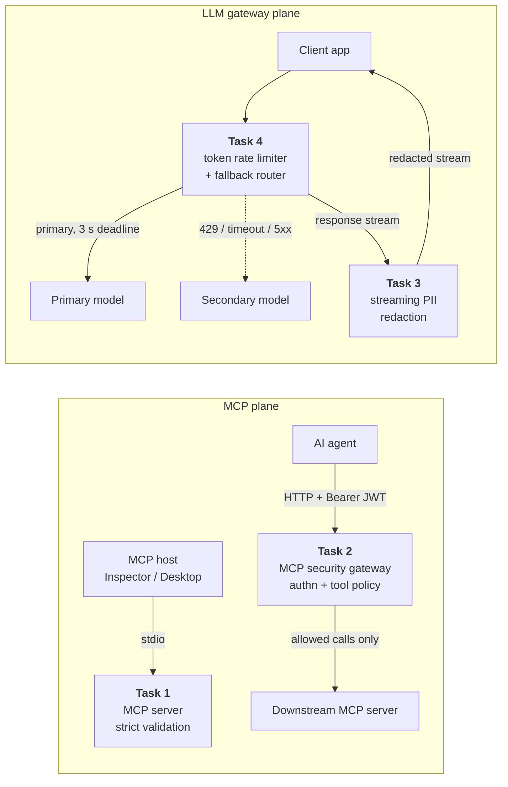

# Solution Architect Assessment — MCP & LLM Gateway Platform

Four production-style components that together form a secure gateway layer for AI agents: a validated MCP server, an MCP security gateway, a streaming PII guardrail and a resilient, rate-limited model router. Each task is self-contained, with its own README covering design decisions, trade-offs and test strategy.



Tasks 3 and 4 run as separate services; the diagram shows how they would chain together in production.

## Quick start

Requires Python 3.11 or newer.

```bash
python -m venv .venv && source .venv/bin/activate
make install        # pip install -e ".[dev]"
make check          # ruff + mypy (strict) + full test suite
```

Without `make` (for example in Windows PowerShell), the same steps are:

```powershell
python -m venv .venv; .venv\Scripts\Activate.ps1
python -m pip install -e ".[dev]"
python -m pytest
```

| Command | What it does |
| --- | --- |
| `make test` | Runs all 258 tests (about 30 s) |
| `make demo-t2` | Starts the MCP gateway and a downstream server, runs admin / viewer / no-token / malformed scenarios, prints the audit log |
| `make demo-t4` | Starts the router and two controllable providers, walks through rate limiting, 429 failover, 3 s timeout failover, total outage and circuit breaker |
| `make bench` | Streaming guardrail throughput, memory and added latency |
| `make run-t1` | Runs the MCP server on stdio (see Task 1 for the Inspector command) |

## Results at a glance

| Task | Built | Key evidence | Tests |
| --- | --- | --- | --- |
| [1 · MCP server](task1_mcp_server/README.md) | `get_customer_record`, `trigger_refund` on the official `mcp` SDK over stdio; Pydantic strict models are the single source of truth for schemas and validation | Invalid input → JSON-RPC `-32602` with per-field details; malformed lines → `-32700` / `-32600`; a subprocess test proves stdout carries only JSON-RPC, even when tool code calls `print()` | 58 |
| [2 · MCP security gateway](task2_mcp_gateway/README.md) | Reverse proxy with signed-JWT roles, strict JSON-RPC parsing and deny-by-default method policy | Viewer calling `admin_reset_key` gets `-32001 Unauthorized Tool Call` and the downstream receives **zero** requests; forged, `alg: none` and expired tokens rejected; case and Unicode bypasses blocked | 54 |
| [3 · Streaming PII guardrail](task3_llm_guardrail/README.md) | OpenAI-compatible SSE proxy redacting emails, SSNs and Luhn-valid card numbers split across chunks | Property tests: streamed output equals whole-text redaction for any chunking; ~4 ms added TTFT; ~6 KiB memory while streaming 5 MB; linear time on adversarial input | 92 |
| [4 · Rate limiter & router](task4_model_router/README.md) | Per-tenant 50k tokens/min sliding window in on-disk SQLite; primary → secondary failover; circuit breaker; standardized errors | 100 concurrent requests → exactly 50 admitted (threads, processes and HTTP); slow primary abandoned at 3.0 s and cancelled; upstream stack traces never reach the client | 54 |

## Repository layout

```
├── task1_mcp_server/      server.py · models.py · store.py · tests/
├── task2_mcp_gateway/     gateway.py · auth.py · jsonrpc.py · policy.py · config.py · mock_mcp_server.py · tests/
├── task3_llm_guardrail/   gateway.py · redactor.py · sse.py · mock_llm.py · bench.py · tests/
├── task4_model_router/    app.py · rate_limiter.py · router.py · providers.py · db.py · errors.py · tokens.py
│                          config.py · admin.py · mock_providers.py · tests/
├── scripts/               demo_task2.sh · demo_task4.sh
├── pyproject.toml         dependency versions, ruff, mypy (strict), pytest
├── Makefile
└── .github/workflows/ci.yml   lint, type check and tests on Python 3.11–3.13
```

## Engineering principles applied throughout

- **Fail closed.** Unknown methods, unknown roles, unparseable tokens and malformed tool names are rejected, never forwarded on a best-effort basis.
- **Precise protocol semantics.** JSON-RPC and MCP error codes are used as the specifications define them, and request ids are echoed whenever they can be recovered.
- **No leakage.** Error responses carry a stable type, a human message and a request id. Upstream bodies, stack traces and hostnames stay in server logs, and rejected input values are never echoed back.
- **Bounded resources.** Body size limits, a constant-size hold-back buffer for streaming, a fixed number of rate-limit rows per tenant, hard deadlines on upstream calls.
- **Proof over assertion.** Each requirement in the brief maps to tests that exercise it: real subprocesses for stdio, real sockets for streaming latency, real processes for the SQLite concurrency guarantee, and property-based tests for the redactor.

## Assumptions

- `CUST-XXXXX` is five ASCII digits.
- Roles are carried in a signed JWT `role` claim (`admin` or `viewer`); HS256 with a shared secret keeps the demo self-contained, and the README for Task 2 describes the move to OIDC/JWKS.
- Mock providers stand in for real LLM APIs. Tasks 3 and 4 work unchanged against any OpenAI-compatible endpoint by setting the environment variables listed in [`.env.example`](.env.example) (export them, or copy the file to `.env` and load it with `set -a; source .env; set +a`).
- Task 4 serves non-streaming completions; how streaming would integrate is described in its README.
